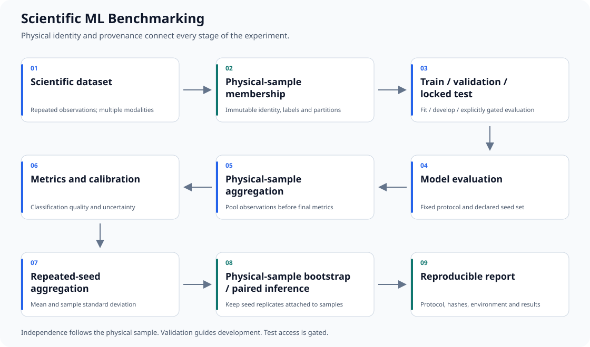

# Scientific ML Benchmarking

Scientific ML Benchmarking is a reusable framework for leakage-safe,
sample-aware evaluation of machine-learning models on scientific datasets with
repeated observations, multiple sensing modalities, and limited physical samples.

## Overview

The physical entity is the unit of separation and inference. An image, crop,
spectrum or seed replicate is not automatically an independent observation.
This initial release provides a working evaluation package, lightweight image
and spectral baselines, synthetic examples and explicit scientific contracts.
It extracts methodology from a real textile-fiber study without distributing
its data, membership IDs, trained weights or historical results.



The [diagram generator](assets/generate_workflow.py) uses only the Python standard
library. Regenerate it with `python assets/generate_workflow.py`.

## Design principles

- Physical samples, not derived observations, define dataset independence.
- Validation drives model development; test evaluation is explicitly gated.
- Statistical inference resamples physical samples, not crops or seed replicates.
- Scientific provenance is treated as part of the experiment rather than metadata added afterward.

## Why physical-sample splitting matters

If crops from one specimen enter both training and test, the model can recognize
specimen-specific texture rather than generalize to unseen specimens. Assign
partitions to physical sample_id first and propagate that membership to every
observation_id and modality. Never split derived observations independently.

## Key features

- Immutable membership validation, optional byte-level reference hash, label
  consistency and derived-observation lineage checks.
- Observation-to-sample probability aggregation with explicit weighting.
- Classification, confusion matrices and top-label ECE.
- Repeated-seed means/SD, stratified physical-sample CIs, paired differences and
  exact McNemar testing separately per seed.
- Train-only preprocessing, portable YAML configuration and aggregate reports.
- Optional wall time, CUDA memory and NVIDIA board-energy telemetry.
- Validation-first entry points and a separate locked-test evaluation gate.

## Repository structure

```text
.github/workflows/tests.yml      compilation, tests and leakage checks
configs/                         image and spectral YAML examples
src/scientific_benchmark/
  splits/                        membership and observation validation
  metrics/                       classification and calibration
  statistics/                    physical-sample bootstrap and paired tests
  preprocessing/                 image crops and spectral units/scaling
  runtime/ energy/               optional telemetry
  reporting/ provenance/ utils/  aggregation, schemas, hashes, seeds, config
  benchmark.py                   frozen-image and SVM spectral baselines
scripts/                         validation, baseline and reporting commands
analysis/                        explicitly post-hoc diagnostics
experiments/                     validation-only spectral window experiment
tests/                           standard-library unittest suite
examples/data/                   entirely synthetic CSV fixtures
docs/                            protocol, contracts, policy, source provenance
results/                         policy only; generated results are ignored
assets/                          reproducible workflow SVG and generator
```

## Quick start

Use Python 3.10+ in a new environment. The core has no GPU requirement.

```bash
python -m pip install -e .
python -m unittest discover -s tests -v
python scripts/validate_split.py examples/data/synthetic_split.csv
python examples/synthetic_benchmark_example.py
```

The synthetic example runs a tiny SVM validation benchmark and cleans up its
temporary outputs. It does not access a real dataset or evaluate test. To keep
synthetic aggregate artifacts:

```bash
python scripts/run_spectral_benchmark.py --config configs/spectral_benchmark_example.yaml
```

Paths resolve relative to the YAML file. `${BENCHMARK_SPLIT}` and
`${BENCHMARK_OBSERVATIONS}` can refer to external private inventories. Unset
variables fail clearly. Result destinations must be fresh.

## Synthetic leakage example

```bash
python examples/synthetic_leakage_example.py
python scripts/validate_split.py examples/data/synthetic_leaked_split.csv
```

Both intentionally exit with status 2 and report physical-sample leakage across
splits. The same synthetic sample appears in train and test. This is expected
failure, not an installation error.

## Image benchmarking

```bash
python -m pip install -e ".[image]"
python scripts/run_image_benchmark.py --config configs/image_benchmark_example.yaml
```

Supply your own immutable split and image inventory using the environment
variables above; edit class labels and modality in the example configuration.
The runner uses a public frozen timm encoder, deterministic overlapping crops,
model-resolved normalization, mean feature aggregation to physical samples,
and a train-only scaled logistic classifier. Public pretrained weights may
download when invoked. CPU is supported. The full original fine-tuning recipes
and private checkpoints are not included or reproduced.

## Spectral benchmarking

Supply a wide observation CSV with named spectral columns, explicit ordered
wavelengths and units. SVM-RBF uses unique physical-sample feature vectors and training-only
stratified sigmoid calibration, with scaling fitted inside each calibration
fold. At least two training physical samples per class are required. Transmittance-to-absorbance conversion is
explicit. There is no silent interpolation or invalid-value repair.
The bundled YAML and CSVs are synthetic. ResNet1D/CNN1D/transformer training,
embedding and retrieval experiments remain outside this initial framework.

## Metrics

Accuracy, balanced accuracy, macro F1, per-class precision/recall/F1 and confusion
matrices use an explicit ordered label schema. Aggregate probabilities to physical
samples before calling final metrics. Multiple modalities remain separate unless
you implement and declare a fusion rule. Probability pooling and feature pooling
are distinct protocols; the baseline runners use feature pooling.

## Calibration

ECE is equal-width, top-label calibration error with ten bins by default.
`expected_calibration_error(..., labels=..., bins=...)` accepts a chosen bin count.
It evaluates calibration; it does not fit a calibrator. Invalid probabilities fail.
Report binning and sample counts, especially for small scientific datasets.

## Statistical inference

`bootstrap_metrics` accepts one row per physical sample and seed. Each bootstrap
replicate resamples within true-class strata and keeps every seed and paired
method attached to the same selected samples. It returns point estimates,
percentile CIs and replicate arrays; paired output columns are method A, method
B, then B minus A. Seed SD is descriptive, not a confidence interval.

```bash
python scripts/bootstrap_metrics.py private/predictions.csv --labels alpha beta --columns prediction_a prediction_b --repetitions 1000
python scripts/aggregate_results.py results/synthetic_spectral/results.json --output results/seed_summary.csv
```

Exact McNemar tests are per seed. Bootstrap intervals condition on observed class
counts and the chosen seed ensemble. See [protocol](docs/experiment_protocol.md).

## Reproducibility

The package never creates a physical-sample split. Record the externally supplied
membership hash, config hash, environment, seeds, observation lineage and
aggregation rule. Source-content attribution is in
[source_provenance.json](docs/source_provenance.json). This records extraction
provenance, not evidence that every original experiment has been reproduced.

```bash
python -m compileall src scripts analysis experiments examples tests
```

## Energy and runtime monitoring

`Timer` records wall time and optional synchronized peak CUDA allocated bytes.
`GPUEnergyMonitor(enabled=True)` uses optional `nvidia-ml-py`, integrates sampled
board power in Wh, and reports missing telemetry without substituting zero.
GPU energy is not total system energy and can include unrelated GPU activity.
Match the NVML physical device to the selected CUDA device. Feature extraction
and per-seed classifier timings are reported separately with explicit scopes.

## Textile-fiber case study

The originating study compares mobile imaging, mobile macro imaging, microscopy
at 7.8x/20x/60x and NIR spectroscopy. Image encoders include ResNet50,
ConvNeXt-Tiny, Swin and DINOv2; spectral research includes SVM-RBF and neural
encoders. This toolkit extracts their evaluation methods, not their results.

The permanent physical membership is 448 samples:

| Class | Train | Validation | Test |
|---|---:|---:|---:|
| CO cotton | 129 | 28 | 28 |
| LI linen | 30 | 6 | 6 |
| NY nylon | 14 | 3 | 3 |
| PO polyester | 32 | 7 | 7 |
| SI silk | 62 | 13 | 14 |
| VI viscose | 19 | 4 | 4 |
| WO wool | 27 | 6 | 6 |
| **Total** | **313** | **67** | **68** |

Canonical membership SHA-256:

```text
a5726d3111941989407b0049e7ba67679e3b846c7e486544467fd926f99dbfc4
```

The membership CSV is private and is not bundled. To validate an externally
supplied canonical file, use `python scripts/validate_split.py <external.csv>
--textile` on one command line. This checks the exact hash and per-class counts,
not just proportions. Never regenerate a nominal 70/15/15 split.

## Test-set policy

The textile test set has already been opened. Do not use its outcomes for new
selection or claim fresh confirmation. Defaults evaluate validation only.
Optional test evaluation requires `--evaluate-test --protocol <locked.json>`;
`--print-protocol` prints a template without fitting. External freezing and
access control remain the researcher's responsibility. A generated hash does
not prove pre-registration. See [policy](docs/test_set_policy.md).

## Known limitations

- No complete historical trainer parity, neural spectral model zoo, pretrained
  research checkpoints, distributed training or automated model search.
- Identity validation cannot discover hidden aliases of one specimen without
  truthful lineage; content duplication and specimen relabeling need a data audit.
- Inventory metadata is read for all partitions; do not store restricted test
  measurements in a shared CSV if even reading those cells is prohibited.
- Image transforms and feature pooling differ from historical probability pooling.
- Fixed class strata, a small sample count and few seeds limit uncertainty claims.
- Optional GPU telemetry and real image inference are hardware-dependent.
- No real-data benchmark results or scientific performance claims are bundled.

## Citation

No DOI or publication identifier is assigned here. Cite the repository title,
version and commit you actually use; add its public URL only after publication.
Do not invent a paper citation. Textile data and institutional assets require
separate permission and attribution.

## License

[MIT](LICENSE) for the extracted software. No dataset, checkpoint or third-party
branding license is granted.
